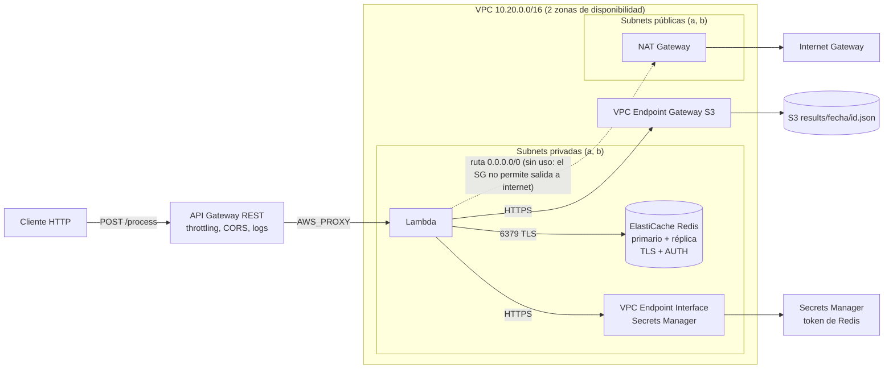

# Servicio de procesamiento serverless con caché (AWS + Terraform)

API HTTP pública que procesa texto con una Lambda dentro de una VPC. Usa Redis (ElastiCache) como caché y guarda cada resultado en S3. Todo se despliega con Terraform, sin pasos manuales.

**Flujo:** `Cliente → API Gateway → Lambda (VPC) → Redis → HIT: responde | MISS: procesa → S3 → Redis (TTL 60 s) → responde`

---

## 1. Arquitectura



```
                    ┌────────────── VPC 10.20.0.0/16 ──────────────┐
 Cliente ─► API GW ─┼─► Lambda (subnets privadas) ──► Redis (TTL 60s)
                    │        │  HIT  ◄───────────────────┘
                    │        │  MISS ─► S3 (vía VPC Endpoint Gateway)
                    │        └─► Secrets Manager (vía VPC Endpoint)
                    └──────────────────────────────────────────────┘
```

### Estructura del repositorio

```
.
├── backend.tf            # Backend remoto del state
├── provider.tf           # Providers (aws, random, archive)
├── main.tf               # VPC, endpoints, SGs, S3, IAM, secreto, Redis, Lambda y API Gateway (por secciones)
├── variables.tf          # Variables con valores por defecto y validaciones
├── outputs.tf            # URL de la API, bucket, endpoint de Redis, etc.
├── terraform.tfvars      # Valores de las variables
├── src/
│   └── handler.py        # Código de la Lambda (Python 3.11)
├── evidence/             # Evidencia del funcionamiento
└── README.md
```

### Recursos principales

| Capa | Recursos |
|---|---|
| Red | VPC, 2 subnets públicas y 2 privadas (2 AZ), IGW, NAT Gateway, tablas de rutas |
| Endpoints | S3 (Gateway, con policy) y Secrets Manager (Interface) |
| Seguridad | Security Groups segmentados, roles IAM de mínimo privilegio, Secrets Manager |
| Cómputo | Lambda en subnets privadas |
| Caché | ElastiCache Redis (replication group, TLS, AUTH, cifrado en reposo) |
| Almacenamiento | S3 privado, versionado, cifrado |
| Entrada | API Gateway REST, stage `prod`, throttling, CORS, logs de acceso |

---

## 2. Pre-requisitos

| Herramienta | Versión |
|---|---|
| Terraform | >= 1.5 |
| AWS CLI | v2 |
| Provider `hashicorp/aws` | >= 5.x (ver `provider.tf`) |
| Providers `random` y `archive` | cualquiera reciente |

**Credenciales:** configúralas con `aws configure` (o SSO) y verifica con `aws sts get-caller-identity`.

**Permisos AWS necesarios:** crear y administrar VPC/EC2 (subnets, NAT, endpoints, SGs), IAM (roles y políticas), Lambda, API Gateway, ElastiCache, S3, Secrets Manager y CloudWatch Logs. Para una prueba basta con un usuario con permisos de administrador.

**Región:** `us-east-1` por defecto (variable `aws_region`).

**Backend remoto:** el state se guarda en el backend definido en `backend.tf`. El state contiene el token de Redis, así que el bucket del backend debe ser privado y estar cifrado.

---

## 3. Despliegue desde cero

```bash
# 1. Clonar
git clone <URL-DEL-REPOSITORIO>
cd <carpeta>

# 2. Ajustar variables (ver sección 7)
#    Editar terraform.tfvars; en admin_principal_arns poner el ARN propio:
aws sts get-caller-identity --query Arn --output text

# 3. Desplegar
terraform init
terraform validate
terraform plan
terraform apply          # escribir "yes"

# 4. Ver outputs
terraform output
```

El `apply` tarda varios minutos, sobre todo por ElastiCache y el NAT Gateway. La Lambda se empaqueta sola desde `src/` con `archive_file`, sin pasos manuales.

### Destruir el stack

```bash
terraform destroy
```

Funciona sin pasos extra gracias a `bucket_force_destroy = true` y `secret_recovery_days = 0` (ver sección 7).

### CI/CD con OIDC (propuesta, fuera del alcance del ejercicio)

El enunciado pide un despliegue con un solo comando y no exige pipeline, por lo que el despliegue de este repositorio es manual. Si se automatizara, la recomendación es **OIDC** en lugar de access keys guardadas como secretos:

1. GitHub Actions pide un token firmado a su proveedor OIDC (`token.actions.githubusercontent.com`).
2. AWS valida el token contra un proveedor de identidad OIDC configurado en IAM.
3. AWS entrega credenciales temporales (STS) para un rol concreto, que caducan en minutos.

No se guarda ninguna credencial de larga duración en el repositorio ni en los secretos del CI.

**Lo que habría que crear en AWS (una sola vez):**
- Un `aws_iam_openid_connect_provider` para `https://token.actions.githubusercontent.com` con audiencia `sts.amazonaws.com`.
- Un rol IAM cuya *trust policy* solo acepte tokens de este repositorio y rama:

```json
{
  "Effect": "Allow",
  "Principal": { "Federated": "arn:aws:iam::<CUENTA>:oidc-provider/token.actions.githubusercontent.com" },
  "Action": "sts:AssumeRoleWithWebIdentity",
  "Condition": {
    "StringEquals": { "token.actions.githubusercontent.com:aud": "sts.amazonaws.com" },
    "StringLike":   { "token.actions.githubusercontent.com:sub": "repo:<ORG>/<REPO>:ref:refs/heads/main" }
  }
}
```

**Permisos del rol:**
- **`plan`** (en pull requests): lectura de los recursos del stack y acceso de lectura al state.
- **`apply`** (solo desde `main`, idealmente con aprobación manual): permisos para crear los servicios del stack (VPC/EC2, IAM, Lambda, API Gateway, ElastiCache, S3, Secrets Manager y CloudWatch Logs) y acceso al backend del state. Como Terraform crea roles IAM, conviene acotarlos con un *permissions boundary*.
- Usar dos roles distintos evita que un pull request pueda modificar infraestructura.

**Ejemplo de workflow (`.github/workflows/terraform.yml`):**

```yaml
permissions:
  id-token: write   # necesario para pedir el token OIDC
  contents: read

jobs:
  terraform:
    runs-on: ubuntu-latest
    steps:
      - uses: actions/checkout@v4
      - uses: aws-actions/configure-aws-credentials@v4
        with:
          role-to-assume: arn:aws:iam::<CUENTA>:role/<ROL-CICD>
          aws-region: us-east-1
      - uses: hashicorp/setup-terraform@v3
      - run: terraform init
      - run: terraform validate
      - run: terraform plan
```

---

## 4. Verificación end-to-end

El body debe ser un JSON con un campo `text`. La Lambda lo invierte, lo guarda en S3 y lo cachea 60 s.

### Bash / curl

```bash
URL=$(terraform output -raw api_url)

# 1ª llamada -> X-Cache: MISS
curl -si -X POST "$URL" -H "Content-Type: application/json" -d '{"text":"hola mundo"}'

# 2ª llamada idéntica, en menos de 60 s -> X-Cache: HIT
curl -si -X POST "$URL" -H "Content-Type: application/json" -d '{"text":"hola mundo"}'

# Objeto guardado en S3
aws s3 ls "s3://$(terraform output -raw s3_bucket)/results/" --recursive
```

### PowerShell

```powershell
$url  = terraform output -raw api_url
$body = '{"text":"hola mundo"}'

# 1ª llamada -> MISS
$r = Invoke-WebRequest -Uri $url -Method POST -ContentType "application/json" -Body $body
"HTTP $($r.StatusCode) | X-Cache: $($r.Headers['X-Cache']) | $($r.Content)"

# 2ª llamada -> HIT
$r = Invoke-WebRequest -Uri $url -Method POST -ContentType "application/json" -Body $body
"HTTP $($r.StatusCode) | X-Cache: $($r.Headers['X-Cache']) | $($r.Content)"

# Objeto en S3
$b = terraform output -raw s3_bucket
aws s3 ls "s3://$b/results/" --recursive
```

### Resultados esperados

| Caso | Request | Respuesta |
|---|---|---|
| Primera llamada | `{"text":"hola mundo"}` | `200` con `X-Cache: MISS` y `s3_key` |
| Misma llamada antes de 60 s | igual | `200` con `X-Cache: HIT` (mismo `s3_key`) |
| Misma llamada después de 60 s | igual | `200` con `X-Cache: MISS` (la key expiró) |
| Body sin `text` o vacío | `{"text":""}` | `400` |
| Excepción interna (p. ej. body no JSON) | `esto no es json` | `500` con `request_id` |

### Comprobar CORS y el error 500

```bash
# Preflight CORS
curl -si -X OPTIONS "$URL"

# Forzar una excepción: el 500 queda registrado en CloudWatch
curl -si -X POST "$URL" -H "Content-Type: application/json" -d 'esto no es json'
aws logs tail /aws/lambda/sre-challenge-processor --since 5m
```

### Evidencia

La carpeta [`evidence/`](./evidence) contiene:

| Archivo | Demuestra |
|---|---|
| `01-miss.txt` | Primera llamada con `X-Cache: MISS` |
| `02-hit.txt` | Misma llamada con `X-Cache: HIT` |
| `03-s3.txt` | Objeto guardado en `results/<fecha>/<id>.json` |
| `04-error500.txt` | Respuesta HTTP 500 con mensaje descriptivo |
| `05-error500-logs.txt` | Traceback del error en CloudWatch |

---

## 5. Manejo de errores y TTL

**Errores (`src/handler.py`)**

- Toda la lógica está dentro de un `try/except Exception`.
- Si el body no es un objeto JSON o falta `text`, responde `400` con un mensaje claro.
- Cualquier otra excepción (JSON inválido, fallo de Redis, de S3 o de Secrets Manager) se registra con `logger.exception` (traceback completo en CloudWatch) y devuelve `500`. La respuesta incluye el `request_id`, para rastrear el error, y no expone detalles internos.
- Todas las respuestas, incluidas las de error, llevan los headers de CORS.
- El cliente Redis reintenta una vez si falla la conexión y se reconecta si el entorno de Lambda estaba "frío".

**TTL**

- Cada escritura en Redis usa `SET <clave> <valor> EX <TTL>`, así que ninguna key se guarda sin expiración.
- El TTL viene de la variable `redis_ttl_seconds` (por defecto 60), que tiene una validación `> 0` para impedir keys permanentes.
- Se comprueba con el comportamiento: HIT dentro de los 60 s y MISS pasados 65 s.

---

## 6. Seguridad

- **Red:** Lambda y Redis solo viven en subnets privadas, y Redis no tiene acceso público.
- **Security Groups con mínimo privilegio:**
  - Redis solo acepta el puerto 6379 desde el SG de Lambda.
  - Lambda solo sale a Redis (6379), a S3 (prefix list del endpoint) y al endpoint de Secrets Manager (443). No hay salida abierta a internet.
- **Secretos:** el token de Redis se genera con `random_password`, se guarda en Secrets Manager y la Lambda lo lee en ejecución con `secretsmanager:GetSecretValue` sobre ese único secreto. No hay secretos en el código ni en variables de entorno.
- **Redis:** TLS en tránsito, token AUTH y cifrado en reposo.
- **S3:**
  - Block Public Access en las 4 opciones, versionado y cifrado AES256.
  - TLS obligatorio (`aws:SecureTransport`).
  - Allow de `PutObject` solo para el rol de Lambda sobre `results/*`.
  - Deny de acceso a objetos a cualquier principal que no sea ese rol (más los ARNs de `admin_principal_arns`).
  - Tráfico a S3 por el VPC Endpoint Gateway, cuya policy solo permite `PutObject` sobre `results/*`.
- **IAM:** el rol de Lambda tiene solo permisos de logs, de ENIs de VPC y los dos permisos específicos de S3 y del secreto.
- **API Gateway:** `data_trace` desactivado para no registrar el contenido de los bodies, y el permiso de invocación limita el origen a `POST /prod/process`.

---

## 7. Decisiones de diseño

### REST API en lugar de HTTP API
Elegí **REST API** porque da control fino a nivel de stage: el throttling por `method_settings`, logs de ejecución y de acceso, y la posibilidad de añadir API keys, usage plans o WAF sin migrar. **HTTP API** es más barata y simple, con CORS nativo, pero ofrece menos controles, y para este servicio prioricé el control.

### ElastiCache Redis
- **Nodo `cache.t3.micro`:** es el más económico y soporta cifrado en tránsito.
- **Replication group:** es necesario para activar TLS y el token AUTH.
- **Primario + réplica en 2 zonas con failover automático (`multi_az_enabled`):** da alta disponibilidad frente a la caída de una zona.

### Secrets Manager + VPC Endpoint
El token no puede ir en el código ni en variables de entorno. Secrets Manager lo almacena, y la Lambda, al no tener salida a internet, lo alcanza por un VPC Endpoint de tipo Interface (tiene costo por hora y por zona).

### NAT Gateway y tráfico saliente de Lambda
El enunciado pide un NAT Gateway en una subnet pública "para tráfico saliente de Lambda". Una Lambda dentro de una VPC pierde el acceso a internet por defecto, y el NAT es lo que se lo devuelve desde una subnet privada: la Lambda inicia la conexión, el NAT traduce su IP privada a una IP pública y el Internet Gateway la saca a internet. Nadie desde internet puede iniciar conexiones hacia las subnets privadas.

**Qué se implementó:**
- Un NAT Gateway (con su Elastic IP) en la subnet pública `a`.
- Las dos tablas de rutas privadas envían `0.0.0.0/0` al NAT.

**Por qué hoy no pasa tráfico por él:** el handler solo habla con Redis (red interna de la VPC), con S3 (VPC Endpoint Gateway) y con Secrets Manager (VPC Endpoint Interface). Ninguno requiere salir a internet, y el Security Group de Lambda bloquea a propósito cualquier salida a internet (mínimo privilegio).

**Cuándo se usaría:** si la Lambda necesitara llamar a una API externa o a un servicio de AWS sin VPC Endpoint. Bastaría con abrir el puerto 443 hacia `0.0.0.0/0` en el SG de Lambda, sin cambiar la red.

Se mantiene un solo NAT por costo. En producción habría uno por zona de disponibilidad.

### Cliente Redis sin dependencias
El handler implementa un cliente RESP mínimo con la librería estándar (`socket`, `ssl`). Así el paquete de la Lambda no necesita librerías de terceros ni capas, y el despliegue sigue siendo un solo `terraform apply`.

### Organización del Terraform
Un único `main.tf` dividido en secciones comentadas (VPC y red, Security Groups, S3, IAM, secreto, Redis, Lambda y API Gateway), con `variables.tf`, `outputs.tf` y `terraform.tfvars` para parametrizar. Para un stack de una sola unidad desplegable, tener todo en un mismo archivo facilita seguir las dependencias entre recursos (por ejemplo, las referencias entre SGs, endpoints, IAM y S3) y auditarlo de una sola lectura.

**Por qué no se usaron módulos:** no hay recursos que se repitan entre entornos, y extraer módulos habría añadido una capa de indirección sin beneficio inmediato. Si el stack creciera o se reutilizara en más entornos, el siguiente paso sería separarlo en archivos por responsabilidad y extraer `vpc`, `redis` y `api_gateway` como módulos.

### Logs de API Gateway: configuración global de la cuenta
Para que API Gateway escriba logs en CloudWatch, la cuenta necesita un rol configurado en `aws_api_gateway_account`. Es una **configuración global: un único valor por cuenta y región, compartido por todas las APIs**.

- **Qué hace y qué no:** solo define el rol que API Gateway puede usar para escribir en CloudWatch. No activa logs en otras APIs, porque cada una sigue necesitando habilitarlos en su propio stage.
- **Primer despliegue en una cuenta o región sin ese rol:** es seguro y necesario. Sin él, el stage con logs falla al desplegarse, y por eso el stack lo crea para poder desplegarse desde cero con un solo comando.
- **Cuenta que ya lo tiene configurado:** el recurso sobrescribiría el rol existente, y al ejecutar `terraform destroy` el rol se borra, por lo que otras APIs de la cuenta podrían quedar sin poder registrar logs. En ese caso se deben eliminar de `main.tf` los tres recursos asociados (`aws_iam_role.api_gw_logs`, su `aws_iam_role_policy_attachment` y `aws_api_gateway_account.main`) y quitar `aws_api_gateway_account.main` del `depends_on` del stage.

### Variables pensadas para entorno de pruebas

| Variable | Valor actual | Recomendado en producción | Motivo |
|---|---|---|---|
| `bucket_force_destroy` | `true` | `false` | Permite que `terraform destroy` vacíe el bucket con objetos y versiones. En producción evita borrar datos por accidente. |
| `secret_recovery_days` | `0` | `7` | Borra el secreto al instante para poder destruir y recrear el stack. En producción deja una ventana de recuperación. |
| `admin_principal_arns` | ARN del operador | ARNs de los administradores | Lista de principales exentos del Deny del bucket, para poder administrarlo y destruirlo. |

### Servicios adicionales y por qué se incluyeron

| Servicio | Motivo |
|---|---|
| Secrets Manager | Guardar el token de Redis fuera del código |
| VPC Endpoint (Secrets Manager) | Leer el secreto sin salir a internet |
| CloudWatch Logs | Logs de Lambda, de acceso y de ejecución de API Gateway, con retención configurable |
| IAM | Roles de mínimo privilegio para Lambda y API Gateway |

---

## 8. Limitaciones conocidas

- **Un solo NAT Gateway** (zona `a`): si esa zona falla, las subnets privadas pierden la salida por NAT. En producción habría uno por zona, con cada tabla de rutas apuntando al NAT de su zona.
- **API pública sin autenticación:** es lo que pide el reto. El throttling mitiga el abuso, y como mejora se pueden añadir API key, WAF o un authorizer.
- **Token de Redis en el state de Terraform:** ElastiCache necesita el token en claro, por lo que queda en el state. El backend debe ser privado y estar cifrado.

---

## 9. Mejoras propuestas: parametrización según el nivel de flexibilidad

El stack parametriza lo que normalmente cambia entre despliegues (región, nombre del proyecto, CIDR de la VPC, tipo de nodo y TTL de Redis, memoria y timeout de Lambda, throttling, retención de logs y las opciones de destrucción). Algunos valores se dejaron fijos a propósito para no multiplicar las combinaciones que habría que probar, y se pueden parametrizar según cuánta flexibilidad se necesite:

| Nivel | Qué se parametrizaría | Cómo | Costo de hacerlo |
|---|---|---|---|
| **Actual (rígido)** | Variables de la sección 7 | `variables.tf` y `terraform.tfvars` | Ninguno: es lo implementado y probado |
| **Intermedio** | `stage_name`, `lambda_runtime`, número de nodos de Redis y los CIDR de las subnets (con `cidrsubnet()` a partir de `vpc_cidr`) | Nuevas variables con valores por defecto iguales a los actuales | Bajo: el plan no cambia, pero `stage_name` aparece en tres lugares (stage, log group de ejecución y permiso de Lambda) y deben cambiar juntos |
| **Alto (flexible)** | Número de zonas de disponibilidad, un NAT por zona con un interruptor, tamaño de subnets, varios entornos (`dev`/`prod`) | `for_each` sobre listas de zonas, un `tfvars` y un backend por ambiente (ver más abajo), y extracción de módulos (`vpc`, `redis`, `api_gateway`) | Alto: cambia las direcciones de los recursos en el state y requiere bloques `moved` y pruebas en cada combinación |

**Criterio aplicado:** se parametrizó lo que cambia entre entornos y se dejó fijo lo que forma parte del contrato del servicio, como el puerto de Redis (6379) o la ruta `POST /process`, de los que dependen el handler, los Security Groups y las pruebas. Más flexibilidad implica más combinaciones que validar, así que para este ejercicio se priorizó un stack simple, probado y reproducible.

### Múltiples ambientes

Para manejar varios ambientes (por ejemplo `dev` y `prod`) se usa el mismo código con un `tfvars` y un backend por ambiente:

```
.
├── main.tf / variables.tf / outputs.tf   # código único
├── envs/
│   ├── dev.tfvars                        # variables del ambiente dev
│   └── prod.tfvars                       # variables del ambiente prod
├── backends/
│   ├── dev.hcl                           # backend de dev: su propio bucket S3, en su región
│   └── prod.hcl                          # backend de prod: su propio bucket S3, en su región
└── bootstrap-state/                      # Terraform aparte que crea los buckets de state
```

**Backend por ambiente:** cada ambiente guarda su state en su propio bucket de S3, ubicado en la región de ese ambiente.

**Cómo se crean los buckets de state:** no los crea este stack. Se preparan antes con un Terraform aparte (`bootstrap-state/`) que crea un bucket por ambiente y devuelve su nombre como output. Ese nombre se coloca en el archivo del backend del ambiente (`backends/<ambiente>.hcl`), de modo que el stack encuentra el bucket ya creado y no depende de crearlo durante su propio despliegue.

```hcl
# backends/dev.hcl
bucket  = "<nombre-del-bucket-de-dev>"   # output del Terraform de estados
key     = "sre-challenge/terraform.tfstate"
region  = "<región-de-dev>"
encrypt = true
```

**Despliegue de un ambiente:**

```bash
terraform init -reconfigure -backend-config=backends/dev.hcl
terraform apply -var-file=envs/dev.tfvars
```

El bloque `backend` de Terraform no admite variables, por eso sus valores se pasan con `-backend-config`.